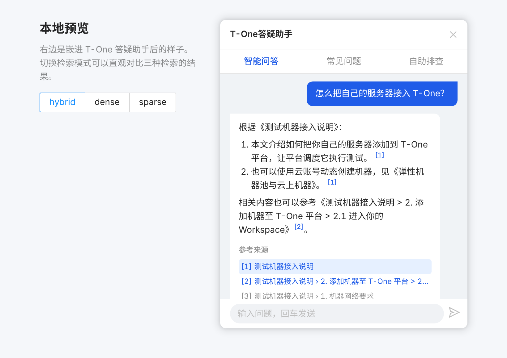
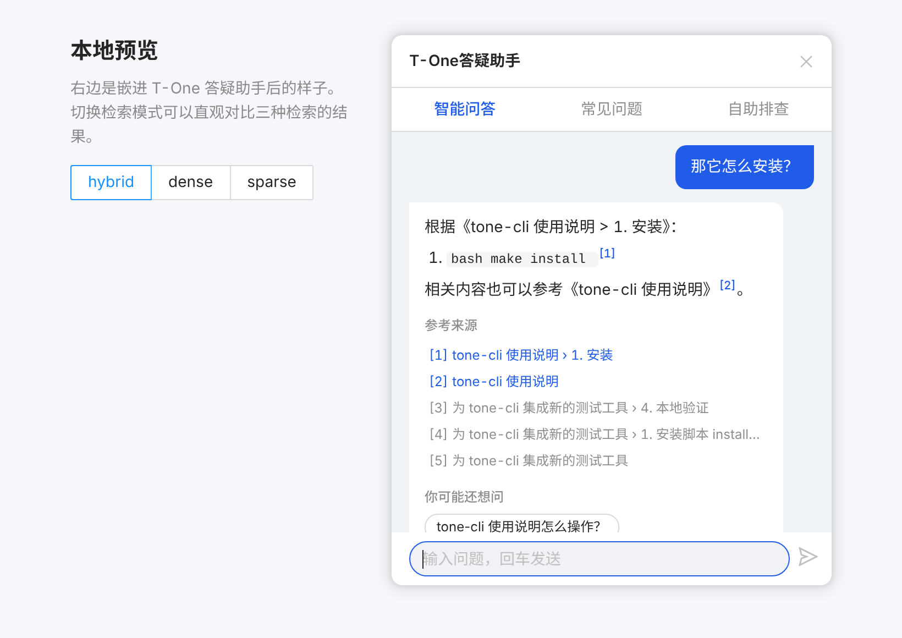

# T-One Intelligent Assistant

[中文说明](README.zh-CN.md)

A document-grounded chat assistant for the OpenAnolis T-One test platform. Ask how to register a server, why a job is still queued, or where to find a ToneAgent log. The chat view returns an answer with numbered citations. Each citation opens the retrieved document, and clicking a suggested follow-up continues the conversation.

<p align="center"> </p>

*The screenshots show the standalone preview with a mock language model.*

## How a question becomes an answer

1. **Index the docs.** The indexer splits Markdown by heading, carries the document title and section into each chunk, and keeps the source URL. Exported T-One help pages retain their original links. The bundled sample pages open through the local API.
2. **Retrieve by keyword and meaning.** BM25 uses Chinese word segmentation and preserves identifiers such as `tone-cli`. A second retriever ranks normalized Chinese sentence embeddings by cosine similarity. Each returns up to 50 chunks. Reciprocal Rank Fusion (`k = 60`) combines the lists and passes the top five chunks to the answer stage.
3. **Answer and cite.** FastAPI returns the answer, source passages, and follow-up questions. An optional OpenAI-compatible model generates the answer and can expand a short follow-up into a standalone query. With no model endpoint configured, the service quotes retrieved passages and uses section headings for follow-ups. The React/TypeScript tab and standalone preview share the same chat component.

## Run the standalone chat

From the repository root, start the backend with Python 3.10+:

```bash
cd backend
python3 -m venv .venv
source .venv/bin/activate
pip install -r requirements.txt
python scripts/build_index.py
uvicorn rag.api:app --port 8000
```

The first index build downloads `BAAI/bge-small-zh-v1.5`. To enable generated answers, copy `backend/.env.example` to `backend/.env` and set the `LLM_*` options before starting the service.

In a second terminal, from the repository root:

```bash
cd playground
npm ci
npm run dev
```

Open [the chat](http://localhost:5173) and try **提交的测试一直在排队是怎么回事？**. Open a numbered citation to inspect the supporting passage. The preview also lets you switch between dense, sparse, and hybrid retrieval for the same question. The [API explorer](http://localhost:8000/docs) exposes the corresponding search, chat, and document endpoints.

## Retrieval evaluation

The repository ships **31 sample documents and 66 labeled Chinese questions** covering T-One and Anolis topics. There are 35 keyword questions and 31 semantic questions. Four questions have two relevant documents. Recall@5 measures the fraction of a question’s labeled documents represented among the first five retrieved chunks, averaged over questions. MRR@10 measures how early the first relevant chunk appears.

| Retriever | Recall@1 | Recall@5 | MRR@10 |
|---|---:|---:|---:|
| BM25 | 0.788 | 0.932 | 0.871 |
| BGE-small-zh-v1.5 | 0.795 | 0.924 | 0.862 |
| BM25 + BGE (default) | 0.788 | **0.992** | **0.886** |
| m3e-small | 0.742 | 0.909 | 0.848 |
| BM25 + m3e | 0.712 | **0.992** | 0.841 |

With the default BGE encoder, hybrid retrieval gained **6.8 percentage points** of Recall@5 over dense-only retrieval (paired bootstrap 95% CI, +1.5 to +13.6 points). All five questions with improved recall were semantic questions. With m3e, hybrid gained 8.3 points at five passages, while MRR@10 fell from 0.848 to 0.841. The scores describe this sample corpus. [BGE results and per-question ranks](docs/evaluation/bge-small-zh-v1.5/) · [m3e results and per-question ranks](docs/evaluation/m3e-small/).

From `backend/`, after building the index:

```bash
python scripts/evaluate.py --eval data/eval/demo_eval.jsonl --sweep
```

`results/summary.json` contains the aggregate scores, results by question type, and a paired bootstrap interval for the hybrid–dense difference. `results/per_question.csv` lists each question’s recall and first relevant rank.

To repeat the m3e run, export `EMBED_MODEL=moka-ai/m3e-small` and `INDEX_DIR=data/index-m3e` in the same shell, rerun the index build, then rerun the evaluation. The result folders record the model revisions and runtime versions.

For an evaluation on a T-One deployment, use `scripts/export_tone_docs.py` to export its help pages, set `DOCS_DIR` to that export, and rebuild the index. `gen_eval_candidates.py` drafts questions. `review_eval.py` lets a reviewer inspect the source and pooled dense/sparse candidates and record relevant document IDs. Pass the resulting label file to the same evaluator.

## Code and credits

| Path | Contents |
|---|---|
| [backend/rag](backend/rag) | Document loading, chunking, ranking, conversational retrieval and FastAPI endpoints |
| [backend/data](backend/data) | Sample documents, domain vocabulary and evaluation labels |
| [backend/tests](backend/tests) | Retrieval, chunking, evaluation and API tests. Run `pytest -q` from `backend/` |
| [RagChat](tone-front/src/components/HelperChatBoot/RagChat) | React/TypeScript chat tab integrated into the T-One help assistant |
| [playground](playground) | Standalone Vite preview. `npm run build` runs strict TypeScript checks and creates the production bundle |
| [tone-front.patch](tone-front.patch) | Frontend changes against the documented upstream revision |

The full platform UI in `tone-front/` requires the T-One web service, pnpm 8, and the assistant API. From `tone-front/`, install with `npx pnpm@8 install` and start with `NODE_OPTIONS=--openssl-legacy-provider npx pnpm@8 start`. In production, route `/api/assistant/` to FastAPI.

This fork extends the existing OpenAnolis help panel. The upstream frontend and its patch use Mulan PSL v2. The backend and standalone preview use MIT. The upstream revision and scope of the changes are recorded in [NOTICE.md](NOTICE.md).
